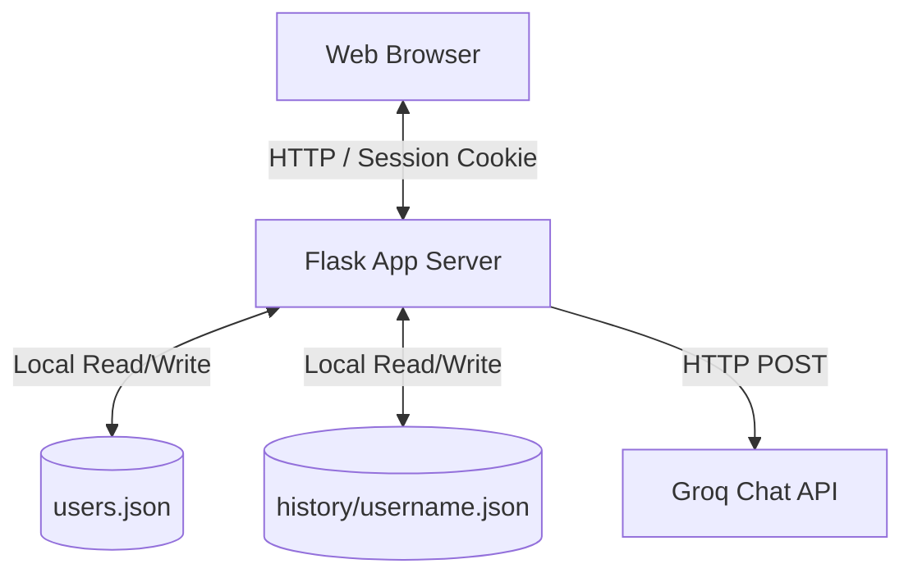

# MentorBot System Documentation

Welcome to the comprehensive documentation of the **MentorBot** application. This document details the system architecture, design patterns, functional components, technical implementation details, and critical architectural flaws of the current implementation.

---

## 1. System Overview & Architecture

MentorBot is a Flask-based web application designed as an adaptive AI programming mentor. It provides users with personalized chat assistance, a daily coding challenge, and an achievement system based on experience points (XP) and badges. 

The application uses **Groq's Cloud API** (specifically Llama-3.3-70b and Llama-3.1-8b models) to dynamically evaluate user queries, adapt explanations to the user's skill level (Beginner, Intermediate, or Advanced), and generate daily coding challenges.

### System Architecture Diagram


### High-Level Request Flow
1. **User Request**: The user interacts with the web browser (sends a chat query, views challenges, or inspects badges).
2. **Authentication & Session Validation**: The Flask application validates the user's state using `Flask-Login` and reads/updates session data.
3. **API Processing**: For AI features, Flask sends synchronous POST requests to the Groq API endpoint (`https://api.groq.com/openai/v1/chat/completions`) using the `requests` library.
4. **Data Persistence**: Read/write operations are performed directly on flat JSON files stored in the server's local directory structure.
5. **Response Rendering**: Flask renders dynamic HTML templates styled with vanilla CSS and returns the payload to the client.

---

## 2. System Design and Data Model

The application uses flat JSON files and the Flask session cookie for all data storage.

### Data Storage Model

#### 1. User Profiles (`users.json`)
A single flat JSON file that stores username-to-password mappings.
```json
{
  "username": "plaintext_password"
}
```

#### 2. Chat History (`history/{username}.json`)
A separate JSON file is maintained for each registered user, grouping messages by date.
```json
{
  "YYYY-MM-DD": [
    {
      "question": "User's query",
      "answer": "Mentor's reply",
      "level": "Beginner | Intermediate | Advanced"
    }
  ]
}
```

#### 3. Flask Session Cookie
Stores short-term user state:
- `xp`: Total experience points (defaults to 0, incremented dynamically).
- `daily_challenges`: A nested dictionary containing challenge text for each day, structured by user:
  ```json
  {
    "username": {
      "YYYY-MM-DD": "AI generated challenge text..."
    }
  }
  ```

---

## 3. Functional Components

### A. Authentication System
- **Sign Up (`/signup`)**: Creates a user entry in `users.json`. Checks if the username is taken; if not, writes the credentials.
- **Login (`/login`)**: Verifies the username and password against `users.json`. If valid, invokes `login_user` to initiate a session and sets the initial session `xp` to 0 (or retains existing session XP).
- **Logout (`/logout`)**: Clears the login session and redirects the user to the login screen.

### B. Adaptive Chat Interface (`/`)
- Displays an empty state or the message history for the current date.
- Contains a list of "Quick Prompts" and "Topics" in the left sidebar to pre-populate the input text area.
- Displays a chat history list on the right sidebar indicating the dates on which chat occurred.
- Processing pipeline for a user message:
  1. **Level Classification**: Sends a request to the `llama-3.3-70b-versatile` model to classify the input as `Beginner`, `Intermediate`, or `Advanced` based on a one-sentence instruction.
  2. **Mentor Response Generation**: Sends a second request to `llama-3.3-70b-versatile` to answer the question, instructing it to tailor the answer to the detected level.
  3. **Metadata Update**: Appends the question, answer, and detected level to the user's daily history file, increments session `xp` by 10, and renders the updated template.

### C. Daily Coding Challenges (`/daily_challenge`)
- Generates a coding challenge dynamically using the `llama-3.1-8b-instant` model if one does not already exist in the user's session for the current date.
- Saves the challenge in the session dictionary (`session["daily_challenges"][username][today]`).
- Awards +20 XP to the user upon generating or loading the daily challenge page.
- Displays "Pro tip" advice and provides buttons to ask MentorBot for help or reload/refresh the page.

### D. Badges & Gamification System (`/badges`)
- Displays a progress bar tracking the user's session XP against milestones (0, 50, 100, 200).
- Dynamically assigns badge achievements based on current session XP:
  - **Beginner Badge (⭐)**: Unlocked at $\ge 50$ XP.
  - **Intermediate Badge (🌟)**: Unlocked at $\ge 100$ XP.
  - **Pro Coder Badge (🏆)**: Unlocked at $\ge 200$ XP.
- Displays locked badges with their unlock requirements if the user hasn't met the criteria.

---

## 4. Technical Implementation Details

- **Backend Framework**: Flask 3.0+
- **Session Management**: Flask-Login 0.6+ (utilizing cookies signed with `secret123`).
- **External API Client**: Python `requests` library communicating with Groq Cloud API endpoints.
- **Model Directory**:
  - Chat/Level Detection: `llama-3.3-70b-versatile`
  - Daily Challenges: `llama-3.1-8b-instant`
- **Front-End Styling**: Vanilla CSS embedded in HTML templates (`base.html`, `index.html`, `daily.html`, `badges.html`, `login.html`, `signup.html`). Uses Google Fonts (Syne, JetBrains Mono, DM Sans) for typography.

---

## 5. Critical System Flaws and Vulnerabilities

The current implementation of MentorBot contains severe architectural, security, and scalability flaws. These must be addressed to elevate the application to a professional standard.

### 🚨 1. Plaintext Password Storage (Critical Security Vulnerability)
- **Problem**: Passwords are saved in `users.json` as cleartext.
- **Consequence**: A server compromise or local directory exposure instantly compromises all user credentials.
- **Fix**: Use cryptographically secure hashing (e.g., `PBKDF2` via `werkzeug.security.generate_password_hash` and `check_password_hash`) to store and verify passwords.

### 🚨 2. Session Cookie Overflow (Critical Architecture Defect)
- **Problem**: The application stores the text of daily challenges in the signed client-side session cookie (`session["daily_challenges"]`).
- **Consequence**: The standard browser limit for HTTP cookies is 4KB. Because AI-generated challenges are verbose, storing even a few daily challenges in the session cookie will exceed this limit. This leads to HTTP 400 Bad Request errors, session corruption, and users being silently signed out continuously.
- **Fix**: Move daily challenges and persistent state out of the Flask session cookie and store them in a backend JSON data store or database.

### 🚨 3. Ephemeral XP & Badges (Design Defect)
- **Problem**: XP and badge achievements are stored solely in the Flask session (`session["xp"]`).
- **Consequence**: Clearing browser cookies, logging out, or session expiration resets the user's XP to 0 and locks their badges.
- **Fix**: Persist XP, unlocked badges, and challenge completion status in the user profile on the server (e.g., within `users.json`).

### 🚨 4. Duplicate Synchronous API Calls (Performance & Cost Defect)
- **Problem**: Every message submission invokes two separate, sequential, synchronous requests to the Groq API: one to detect the level and one to generate the mentor response.
- **Consequence**: Response latency is doubled (typically exceeding 3–5 seconds), API token usage is doubled, and the server thread blocks during both operations.
- **Fix**: Combine level detection and content generation into a single request using Groq's JSON mode, or cache/persist the user's skill level in their profile rather than re-detecting it on every single prompt.

### 🚨 5. Stateless Chat / Missing Context (Functional Defect)
- **Problem**: The API call for the mentor response only passes the current user input:
  ```python
  "messages": [
      {"role": "system", "content": f"You're a coding mentor. Give short, clear answers for a {level} learner."},
      {"role": "user", "content": user_input}
  ]
  ```
- **Consequence**: The chatbot has no memory. If a user asks "Can you explain the code you just wrote?" or "How do I run that?", the bot cannot provide a logical response because the conversation history is omitted.
- **Fix**: Append a truncated or summarized conversation window (e.g., the last 5–10 messages) to the LLM query context.

### 🚨 6. Thread-Unsafe File I/O (Concurrency Vulnerability)
- **Problem**: File reads and writes to `users.json` and `history/*.json` are executed concurrently without locking mechanisms.
- **Consequence**: Multiple concurrent requests from different users can lead to race conditions, leading to data loss, corruption of JSON files, and server crashes.
- **Fix**: Implement thread locks (using `threading.Lock`) or use a structured SQLite database with transactions.

### 🚨 7. Unsafe Error Handling & Broken UX
- **Problem**: When API keys are missing or requests fail, the application returns raw string responses like `"API Key missing!"` or `"Please enter a question"`.
- **Consequence**: The clean HTML structure is completely lost, rendering a blank page with a plain-text error, forcing the user to manually hit the back button.
- **Fix**: Implement standard Flask flash messaging or render error blocks gracefully inside the existing template framework.

### 🚨 8. Hardcoded Security Keys
- **Problem**: `app.secret_key` is hardcoded to `"secret123"`.
- **Consequence**: Anyone with access to the source code can decrypt, spoof, or manipulate session cookies.
- **Fix**: Read the session secret key from the `.env` file and generate a cryptographically secure random value if none is specified.

### 🚨 9. Daily Challenge XP Exploits
- **Problem**: Merely loading the daily challenge page adds +20 XP to the session.
- **Consequence**: Users can refresh the page or clear cookies to continuously accumulate infinite XP without ever solving a challenge.
- **Fix**: Award XP only when the user submits a correct solution to the daily challenge, and track completions in the database to prevent double-claiming.
